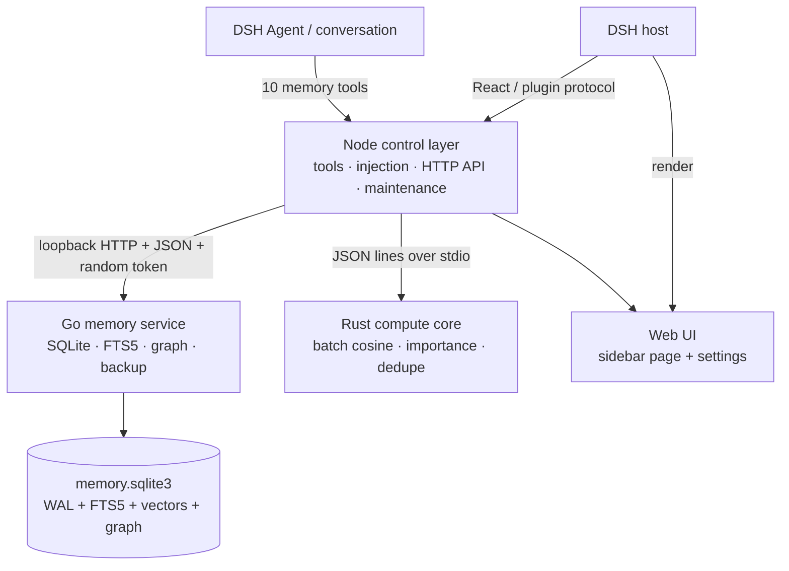

<p align="center">
  
</p>

<h1 align="center">dsh-Immunity-memory</h1>

<p align="center"><strong>Cross-session long-term memory for DeepSeek Harness.</strong></p>

<p align="center">
  <a href="README.md">简体中文</a> ·
  <a href="README.en.md">English</a>
</p>

<p align="center">
  
  
  
  
  
  
</p>

> The technical plugin id remains **`dsh-memory-plugin`**; the repository and project name is **`dsh-Immunity-memory`**. The rename only affects branding, not existing installs, config paths, or tool names.

---

## Why "Immunity"

Context windows get cleared, sessions get switched, and models forget what happened yesterday. **Immunity** does not mean "remember everything". It means making the agent immune to:

- **Amnesia**: goals, preferences, decisions, pitfalls, and project facts survive across sessions;
- **Memory pollution**: layers, deduplication, conflict detection, TTLs, and consolidation audits keep stale or duplicate memories out of the prompt;
- **Black boxes**: every write, update, delete, consolidation, and injection is auditable; the UI exposes diffs, usage, and backups;
- **Lock-in**: data lives in local SQLite, with no cloud memory service. Missing Go/Rust components degrade gracefully instead of breaking the plugin.

This is not "dump the chat history into a JSON file", and it is not "wrap a vector database". It is a complete local memory subsystem: **Node control layer + Go persistence/retrieval service + Rust native compute core + visual UI**.

## What it solves

| Problem | Typical approach | Immunity |
| --- | --- | --- |
| Everything is forgotten after a session | Copy chat logs manually | 10 agent tools for write, search, update, and consolidation |
| Memory becomes a junk drawer | One flat list | Eight layers + four notebooks + type/layer/tag filters |
| Retrieval is keyword-only | `LIKE` or a single vector search | FTS5 bm25 + 384-d vector cosine + graph BFS, fused |
| Stale memories pollute context | Keep everything forever | Hard TTL, expiry archive, conflict detection, consolidation audit |
| No idea what was injected | Opaque prompt | Injection preview, per-layer token stats, usage ledger, diff view |
| Data lives in the cloud | SaaS memory service | Local SQLite, backup/restore, export/import, offline |
| Switching tools loses memory | Proprietary silo | DSH plugin protocol + plain HTTP/JSON + portable data |

## Features

| Feature | Description |
| --- | --- |
| **Eight layers** | L0 Soul, L1 Core Thoughts, L2 Thought Flow, L3 Instincts, L4 Learned Behavior, L5 Goals, L6 Rotating Memory, L7 Situational Awareness. L0/L1/L3 are immutable by default; the agent chooses among L2/L4-L7 for mutable memories |
| **Four notebooks** | Memory, Daily, Asset, Pitfall. Pitfall notes use the fixed "symptom / root cause / fix / prevention" shape and support record / search / check |
| **Hybrid retrieval** | FTS5 bm25 + 384-d hashed-vector cosine + graph BFS; default weights 0.4 / 0.4 / 0.2, auto-normalized and configurable |
| **Write protection** | Minimum content length, Jaccard dedupe, immutable-layer protection, L2 conflict detection; every mutable write/update must provide explicit `ttlDays`, never a silent permanent default |
| **Memory templates** | Each template configures immutable memories per L0/L1/L3, with multiple templates and hot switching; L2 and L4-L7 are shared and are never copied or deleted by a switch |
| **Write audit** | Before every `memory_write` / `memory_update`, an isolated subagent audits it against the user's turn; optional enforce or shadow mode, with pending candidates approved in the UI and per-run token accounting |
| **Consolidation** | Frequently written, updated, or recalled memories become candidates; after `memory_consolidate` review or UI approval they become permanent L1/L3 memories, fully audited |
| **Prompt injection** | The most relevant memories are injected into the system prompt each turn; the page shows total injected tokens and a per-layer breakdown; preview and disable are supported |
| **Usage ledger** | Records query tokens and result tokens per search, split by tool/type; the notebook view counts queries whose results include notebook entries |
| **Change diff** | Create/update/delete/bulk/consolidate snapshots; the UI renders a git-style red/green diff with line-level LCS, while agents receive lossless JSON |
| **Maintenance** | Resource caps, expiry cleanup, rotation archive, dedupe, reflection promotion, consolidation scan, audit/changelog compaction; scheduled or manual |
| **Data safety** | WAL, versioned migrations, integrity checks, scheduled/manual backups, restore, export/import |
| **Visual UI** | Sidebar "Memory" page: memories, notebooks, pitfalls, changes, usage, consolidation, audit, settings, maintenance; Chinese/English UI switch |
| **Local-first** | Zero runtime npm dependencies; local SQLite; missing Go/Rust binaries fall back with an explicit warning |

## Architecture



| Layer | Language / artifact | Responsibility |
| --- | --- | --- |
| Control | Node.js (host process) | `apply(ctx)`, 10 tools, prompt injection, UI HTTP API, maintenance/backup orchestration, fallback when native components are unavailable |
| Service | Go → `packages/memory-plugin/bin/<platform>-<arch>/memory-service` | SQLite persistence, FTS5 (bm25), vector cosine, graph BFS, audit, backup, integrity checks, graceful shutdown |
| Compute | Rust → `packages/memory-plugin/native/<platform>-<arch>/memory-core` | Batch cosine, importance scoring, dedupe/similarity (JSON lines over stdio) |
| UI | Browser-side JS (no build step) | Sidebar page + `settings.section`; lists, search, editor, templates, usage, consolidation, diff, maintenance |

Why this split:

- Plugin entry points and browser components must be JS (cordis contract), but storage and computation do not.
- Node's built-in `node:sqlite` has no FTS5; Go's `modernc.org/sqlite` is pure Go, cgo-free, and ships FTS5.
- The design's gRPC is replaced by **loopback HTTP + JSON + a random token**: zero extra Node dependencies, no network install, no `.proto` toolchain.
- If the Go/Rust binary is missing or fails to start, the plugin falls back to the Node implementation (no FTS5, degraded retrieval) and says so in logs and settings instead of failing silently.

## Memory model

### Eight layers

| Layer | Name | Role | Typical content |
| --- | --- | --- | --- |
| L0 | Soul | Immutable identity and boundaries | Values, principles, non-negotiable constraints |
| L1 | Core Thoughts | Long-term core cognition | Stable conclusions, methodologies, important decisions |
| L2 | Thought Flow | Mutable, conflict-checked | Emerging ideas, hypotheses, unverified conclusions |
| L3 | Instincts | Immutable behavior | Fixed workflows, reaction patterns, operating rules |
| L4 | Learned Behavior | Mutable | Project facts, lessons, pitfalls, technical details |
| L5 | Goals | Mutable | Long-term objectives, plans, directions |
| L6 | Rotating Memory | Mutable, strict TTL | Temporary context, short-lived state, session residue |
| L7 | Situational Awareness | Mutable | Environment, device, preferences, current scenario |

L0/L1/L3 are configured through templates; switching a template replaces only these three layers. L2/L4-L7 are global shared mutable memories and are never copied or deleted by a template switch.

### TTL is a hard constraint

Except for immutable L0/L1/L3, every write or update to a mutable layer must provide `ttlDays`; omitting it returns `TTL_REQUIRED`. Expired entries are archived as `expired` by maintenance and are not silently renewed. Only after consolidation review promotes an entry permanently to L1/L3 does it lose its TTL.

### Templates

A template is a reusable set of immutable configuration, not a copy of the whole memory store:

```json
{
  "id": "tpl_example",
  "name": "Project A",
  "header": "You are assisting with Project A.",
  "topN": 8,
  "maxChars": 4000,
  "layers": {
    "L0": [{ "title": "Principle", "content": "Verify before concluding." }],
    "L1": [{ "title": "Architecture", "content": "Node control layer / Go service / Rust core." }],
    "L3": [{ "title": "Habit", "content": "Run node scripts/check.mjs after code changes." }]
  }
}
```

## Quick start

### Requirements

| Component | Version | Required |
| --- | --- | --- |
| DeepSeek Harness (DSH) | A desktop build with `plugin_manager` | Yes |
| Node.js | 22+ (24 recommended) | Yes |
| Go | 1.26+ | Only to build the Go service from source |
| Rust | stable | Only to build the native core from source |

The repository ships **Windows x64** binaries for `memory-service.exe` and `memory-core.exe`; a normal install needs no Go/Rust toolchain. Linux/macOS users should build the matching platform directory with the scripts.

### Install

```pwsh
git clone https://github.com/theBeautifulIce/dsh-Immunity-memory.git
cd dsh-Immunity-memory

# Optional: run the self-check first
node scripts/check.mjs
```

Ask the DSH agent to install it (replace the path with your local checkout):

```text
plugin_manager action=install_bundle target=<repo>/packages/memory-plugin
```

Open a new session after installation. If you are replacing an installed version, restart DSH or reload the plugin. Refresh the page and click the "Memory" icon in the sidebar.

### Build native components from source

```pwsh
node scripts/build-go.mjs       # Go; writes bin/<platform>-<arch>/memory-service
node scripts/build-native.mjs   # Rust; writes native/<platform>-<arch>/memory-core
node scripts/check.mjs
```

### Data location

Default:

```text
%USERPROFILE%\.dsh\storages\dsh-memory-plugin\memory.sqlite3
```

Override with `DSH_HOME` or Settings → Storage → Data directory. Main tables:

`memories` / `events` / `assets` / `relationships` / `changelog` / `config` / `schema_migrations` / `service_migrations`, plus `items_fts` (FTS5), `memory_vectors`, and `items_meta` for retrieval.

At startup the Go binary is copied to `<store-dir>\service\<platform>-<arch>\` before execution, so install directories (especially `link:` development installs) are not constrained by host sandbox or read-only policies.

## The 10 agent tools

| Tool | Purpose |
| --- | --- |
| `memory_write` | Write a memory or notebook entry; the agent must choose a mutable layer and provide `ttlDays`; optional entity `key`, source `quote`, and `supersedes` |
| `memory_search` | Hybrid retrieval; returns score breakdown, layer, tags, and match reasons |
| `memory_get` | Read full content, entity key, and source quote by id |
| `memory_update` | Change title, content, tags, importance, layer, TTL; increments version; supports `key` and `supersedes` |
| `memory_forget` | Delete an entry and clean up conflict references |
| `memory_stats` | Entry counts, layer/type distribution, storage and health |
| `memory_usage` | Query the token usage ledger, split by tool/type |
| `memory_consolidate` | List candidates, review, and promote to L1/L3 |
| `memory_pitfall` | Record / search / check pitfall notes |
| `memory_diff` | Filter structured change history by time, entity, layer, item, and operation |

All tools return **lossless JSON**; human formatting happens only in the UI.

## UI

The sidebar "Memory" page includes:

- **Memories**: layer list, search, filters, editor, bulk archive/pin/layer changes;
- **Notebooks**: Memory / Daily / Asset / Pitfall, editable entries;
- **Pitfalls**: four-part notes with duplicate checks and search;
- **Changes**: git-style red/green diff with time/entity/layer/operation filters;
- **Usage**: query and result token ledger;
- **Consolidation**: candidates, review, approve/reject;
- **Audit**: write-audit toggle, accumulated tokens, pending candidates, approve/reject, and recent runs;
- **Settings**: general, storage, retrieval, write, layer toggles, prompt injection, maintenance, performance, privacy, tools;
- **Maintenance**: resource caps, expiry cleanup, rotation, dedupe, reflection promotion, backup/restore;
- **Language**: Chinese / English UI switch (`ui.language = auto | zh | en`).

## Configuration highlights

Settings save immediately and can be reset to defaults. The most useful keys:

| Setting | Default | Description |
| --- | --- | --- |
| `storage.engine` | `auto` | `auto` / `go` / `sqlite` / `json`; `auto` prefers the Go service and falls back to Node SQLite |
| `retrieval.weights` | `0.4 / 0.4 / 0.2` | Full-text / semantic / graph fusion weights, auto-normalized |
| `retrieval.graphDepth` | `2` | Graph BFS depth |
| `retrieval.graphMinWeight` | `0.5` | Minimum graph edge weight |
| `write.dedupeThreshold` | `0.9` | Jaccard duplicate threshold |
| `write.defaultTtlDays` | `30` | Suggested TTL for new mutable entries; an explicit value is still required |
| `prompt.inject` | `true` | Inject memories into the system prompt |
| `prompt.topN` / `maxChars` | Template-defined | Injection count and character budget |
| `consolidation.autoApply` | `false` | Off = candidates only; consolidation requires review |
| `hook.enabled` | `false` | Write-audit hook; off by default |
| `hook.enforce` | `true` | Block rejected writes; off records shadow audits only |
| `hook.minConfidence` | `0.7` | Rejects below this confidence do not block; `needs_user` always queues |
| `hook.timeoutSeconds` | `45` | Subagent audit timeout; timeouts fail open |
| `maintenance.*` | See Settings | Maintenance interval, archive age, resource caps, audit retention |
| `storage.backupKeep` | `3` | Rotating backups to keep |
| `performance.nativeCore` | `true` | Enable the Rust native core |
| `tools.enabled` | `true` | Expose memory tools to the model |

The full schema lives in `packages/memory-plugin/lib/settings.js`; the UI renders it automatically.

## Data, privacy, and boundaries

- **Local-first**: the memory store, backups, and audit are local; the plugin calls no cloud memory API and needs no extra key.
- **Prompt boundary**: only retrieved/injected entries enter the model context. "Local storage" does not mean "the model cannot see it". Use layer toggles, `tools.enabled`, or privacy settings for sensitive content.
- **Audit**: writes, updates, deletes, consolidation, and maintenance are recorded. With the write-audit hook enabled, the audit subagent's token usage is accumulated and shown too. `privacy.auditLog` can be disabled, but that also disables the change diff.
- **Backups**: scheduled/manual backup, restore, export/import. Backup files contain sensitive data; protect them like the database.
- **Deletion**: `memory_forget` deletes the entry and cleans up conflict references; deleted entries are not injected. If audit is enabled, the deletion action itself remains in change history.
- **Fallback**: if the Go service is unavailable, the plugin falls back to Node SQLite (no FTS5) or JSON; Settings shows the actual engine so you are not misled about the performance path.

## Performance

Reference numbers on Windows x64 with 2,000 memories (see [`docs/性能报告.md`](docs/性能报告.md)):

| Scenario | Result |
| --- | --- |
| Bulk import | ~2,060 entries/s |
| Single write | 12.6 ms |
| Hybrid retrieval | 6.5 ms (p95 8.8 ms) |
| Graph BFS | 0.49 ms |
| Rust batch cosine | ~30,900 pairs/s |

Numbers vary with hardware, data distribution, and whether the native core is enabled. Reproduce with `scripts/benchmark.mjs`.

## Repository layout

```text
.
├─ docs/
│  ├─ design/                 # requirements and implementation design
│  ├─ reference/              # reference implementations (Go / Rust / gRPC)
│  ├─ 开发说明.md             # architecture, data model, retrieval, build, test, release
│  └─ 性能报告.md             # benchmark results
├─ go-service/                # Go service: text / store / search / api
├─ native/memory-core/        # Rust compute core (cargo)
├─ packages/memory-plugin/
│  ├─ index.js                # host entry: tools / injection / timers / API / lifecycle
│  ├─ client.js               # sidebar page + settings (React.createElement, no build)
│  ├─ lib/
│  │  ├─ engine.js            # memory engine: CRUD, retrieval routing, conflict, maintenance, export
│  │  ├─ go-store.js          # Go client: spawn, handshake, incremental sync, search, backup
│  │  ├─ storage.js           # storage selection: Go → Node SQLite → JSON
│  │  ├─ search.js            # Node fallback: BM25 + cosine + graph + fusion
│  │  ├─ sqlite.js            # Node fallback: migrations, vectors, backup
│  │  ├─ native.js            # Rust core client (automatic JS fallback)
│  │  ├─ settings.js / api.js / tools.js
│  │  └─ text.js / embeddings.js / fallback-math.js
│  ├─ bin/<platform>-<arch>/  # Go service shipped with the plugin
│  ├─ native/<platform>-<arch>/# Rust core shipped with the plugin
│  └─ locale/                 # Chinese/English plugin metadata
├─ scripts/                   # build / check / benchmark / inspect / probe
├─ tests/                     # engine / engine-go / tools / search / sqlite / native / api / render
├─ CHANGELOG.md
├─ ROADMAP.md
├─ CONTRIBUTING.md
└─ SECURITY.md
```

## Development and testing

```pwsh
node scripts/check.mjs        # all tests: syntax, engine, tools, storage, retrieval, native, Go, API, render
node tests/engine.test.mjs    # engine only
node tests/go-service.test.mjs
node scripts/benchmark.mjs --items 2000 --queries 100 --graph 50 --out docs/性能报告.md
node scripts/inspect-db.mjs   # read-only view of the current memory store
```

- **Zero runtime npm dependencies**; React is provided by the DSH host.
- When native components are missing, tests automatically exercise the JS fallback.
- Code style, data model, retrieval formulas, and migration strategy: [`docs/开发说明.md`](docs/开发说明.md).
- Before committing, `node scripts/check.mjs` must be green.

## Long-term maintenance

This repository is maintained as a long-lived project, not a one-off script:

- **Semantic versioning**: `0.x` may change interfaces, but every change is recorded in [`CHANGELOG.md`](CHANGELOG.md);
- **Branching**: `main` stays installable; feature branches + PRs; full self-check before merge;
- **Release**: bump version → update CHANGELOG → rebuild Windows binaries → tag → attach artifacts;
- **Issues**: templates distinguish bugs and feature requests; roadmap in [`ROADMAP.md`](ROADMAP.md);
- **Security**: report sensitive issues privately per [`SECURITY.md`](SECURITY.md); never paste tokens or memory databases into public issues;
- **Contributing**: environment, tests, and PR rules in [`CONTRIBUTING.md`](CONTRIBUTING.md).

## Roadmap

Near-term priorities:

1. **Cross-platform releases**: Linux/macOS prebuilt binaries and a release pipeline;
2. **Retrieval quality**: pluggable embeddings, real semantic model adapters, retrieval evaluation set;
3. **Memory quality**: conflict merge policy, forgetting curve, per-project memory spaces;
4. **Observability**: maintenance dashboard, slow queries, injection hit rate, memory health score;
5. **Ecosystem**: install directly from GitHub, upgrade/rollback, example template packs.

See [`ROADMAP.md`](ROADMAP.md) for details.

## Contributing and license

Issues, PRs, templates, and pitfall reports are welcome. Please read [`CONTRIBUTING.md`](CONTRIBUTING.md) first.

Licensed under the [MIT License](LICENSE).
