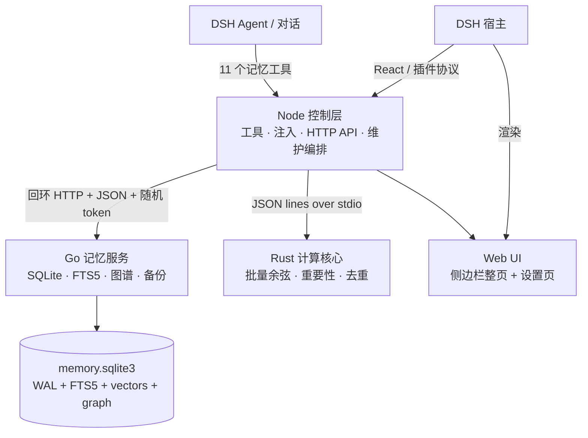

<p align="center">
  
</p>

<h1 align="center">dsh-Immunity-memory</h1>

<p align="center"><strong>给 DeepSeek Harness 的跨会话长期记忆层。</strong></p>

<p align="center">
  <a href="README.md">简体中文</a> ·
  <a href="README.en.md">English</a>
</p>

<p align="center">
  
  
  
  
  
  
</p>

> 技术插件 id 仍为 **`dsh-memory-plugin`**，仓库与项目名为 **`dsh-Immunity-memory`**。改名只影响项目品牌，不影响已有安装、配置路径或工具名。

> **v0.4.0 新增**：自动记忆触发（用户纠错 / 让记住 / 满意或不满 / 智能体自省）、小时与每日回顾队列、`memory_capture` 工具、记事本代码去重；写什么、写哪一层、TTL 多长仍由智能体判断。详见 [Release v0.4.0](https://github.com/theBeautifulIce/dsh-Immunity-memory/releases/tag/v0.4.0)。

---

## 为什么叫 Immunity

上下文窗口会被清空，会话会被切换，模型会忘记昨天做过什么。**Immunity** 指的不是“记住所有东西”，而是让 agent 对以下问题产生免疫力：

- **失忆**：跨会话保留目标、偏好、决策、踩坑与项目事实；
- **污染**：用分层、去重、冲突检测、保鲜期和固化审计，阻止过期或重复记忆进入提示词；
- **黑盒**：每条记忆的写入、修改、删除、固化和注入都有记录，可在界面里查 diff、看用量、做备份；
- **锁定**：数据保存在本机 SQLite，不依赖云端记忆服务；Go / Rust 组件缺失时自动降级，而不是直接罢工。

它不是“把聊天记录塞进一个 JSON 文件”，也不是“只包一层向量数据库”。它是一个完整的本地记忆子系统：**Node 控制层 + Go 持久化/检索服务 + Rust 原生计算核心 + 可视化界面**。

## 它解决什么问题

| 问题 | 传统做法 | Immunity 的做法 |
| --- | --- | --- |
| 会话结束后忘光 | 手动复制聊天记录 | 11 个 agent 工具自动写入、检索、更新、捕获、固化 |
| 记忆越堆越乱 | 全部塞进一个列表 | 八层记忆 + 四本记事本 + 类型/层/标签过滤 |
| 检索只靠关键词 | `LIKE` 或单路向量 | FTS5 bm25 + 384 维向量 + 图谱 BFS，三路融合 |
| 旧记忆污染上下文 | 永久保留 | 保鲜期硬约束、过期归档、冲突检测、固化审计 |
| 不知道注入了什么 | 黑盒 prompt | 注入预览、逐层 token 统计、用量账本、变更 diff |
| 数据在云端 | SaaS 记忆服务 | 本地 SQLite、备份/恢复、导出/导入、离线可用 |
| 换模型/换宿主就丢 | 绑定单一产品 | DSH 插件协议 + 标准 HTTP/JSON + 可迁移数据 |

## 核心能力

| 能力 | 说明 |
| --- | --- |
| **八层记忆** | L0 灵魂层、L1 思想核心、L2 思想流动、L3 本能行为、L4 学习行为、L5 目标记忆、L6 轮转记忆、L7 情境感知；L0/L1/L3 默认不可改写，L2/L4-L7 由智能体按内容选择 |
| **四本记事本** | 记忆、日常、资产、踩坑；踩坑笔记固定“现象 / 根因 / 解决办法 / 预防”四段，支持 record / search / check |
| **混合检索** | FTS5 bm25 全文 + 384 维哈希向量余弦 + 关系图谱 BFS；默认权重 0.4 / 0.4 / 0.2，自动归一化，可按设置调整 |
| **写入保护** | 最小正文长度、Jaccard 去重、不可变层只读、L2 冲突检测；可修改层写入和修改必须显式填写 `ttlDays`，绝不默认永久 |
| **冲突解决** | L2 冲突可显式「保留一侧」或「合并正文/标签」；败者归档并写取代关系，全程审计 |
| **遗忘曲线** | 按最后访问时间做指数衰减，半衰期与分数地板可调；只影响检索排序，不改写 importance |
| **项目空间** | 条目可绑定 `workspace`；写入默认当前工作目录，检索默认当前项目 + 全局，`"*"` 可跨项目 |
| **写入 Hook** | `createItem` / `updateItem` / 导入 / 冲突解决支持 before/after 生命周期 Hook，可改写、可拦截、失败放行 |
| **自动记忆** | 检测用户纠错、让记住、明显满意/不满与智能体自省；按小时/每日入队提醒。插件只发提醒，写什么、写哪层、TTL 多长由智能体调用 `memory_capture` 决定；记事本按同本归一化正文去重 |
| **诊断** | 记忆健康分、维护历史、慢查询、注入命中率，统一在维护面板和 `diagnostics` API 展示 |
| **记忆模板** | 每个模板按 L0/L1/L3 逐条配置不可变记忆，可新增多套并热切换；L2 与 L4-L7 始终共享，不会因切换模板被复制或删除 |
| **写入审计** | 每次 `memory_write` / `memory_update` 前由无工具权限的独立子智能体对照用户原话审计；可开关、可影子运行，失败/超时放行；待确认候选在界面批准后才落库，审计 token 计入账本 |
| **固化机制** | 反复写入、更新或命中的记忆进入候选；经 `memory_consolidate` 审计或界面确认后永久固化到 L1/L3，全程写审计 |
| **提示词注入** | 每轮把最相关的记忆拼进系统提示词；页面显示注入 token 总量，展开可看逐层消耗；可预览、可关闭 |
| **用量账本** | 记录每次检索的查询 token、结果 token，按工具/类型拆分；记事本视图统计含记事本结果的查询 |
| **变更 diff** | 创建/更新/删除/批量/固化都有前后快照；界面用 git 风格红绿差异展示，正文按行 LCS，智能体拿到无损 JSON |
| **自动维护** | 资源上限、过期清理、轮转归档、去重、反思提升、固化扫描、审计与变更历史压缩；支持定时与手动触发 |
| **数据安全** | WAL、版本化迁移、完整性校验、定时/手动备份、备份恢复、导出/导入 |
| **可视界面** | 左侧栏「记忆」整页：记忆、记事本、踩坑、变更、用量、固化、审计、设置、维护；支持中文/英文界面切换 |
| **本地优先** | 运行期零 npm 依赖；数据在本机 SQLite；Go/Rust 二进制缺失时自动回退并明确标注 |

## 架构



| 层 | 语言 / 产物 | 职责 |
| --- | --- | --- |
| 控制层 | Node.js（宿主进程） | 插件入口 `apply(ctx)`、11 个工具、提示词注入、界面 HTTP 接口、维护与备份编排、原生组件缺失时的降级 |
| 服务层 | Go → `packages/memory-plugin/bin/<platform>-<arch>/memory-service` | SQLite 持久化、FTS5（bm25）、向量余弦、关系图谱 BFS、审计、备份、完整性校验、优雅退出 |
| 计算核心 | Rust → `packages/memory-plugin/native/<platform>-<arch>/memory-core` | 批量余弦、重要性评分、去重/相似度（JSON lines over stdio） |
| 界面层 | 浏览器端 JS（无构建） | 侧边栏整页 + `settings.section`；列表、搜索、编辑器、模板、用量、固化、diff、维护 |

为什么这样切：

- 插件宿主入口与浏览器端组件必须是 JS（cordis 契约），但计算和持久化没有这个限制。
- Node 自带 `node:sqlite` 没有 FTS5；Go 的 `modernc.org/sqlite` 是纯 Go、免 cgo，FTS5 开箱可用。
- 设计中的 gRPC 用**回环 HTTP + JSON + 随机 token** 替代：Node 侧零额外依赖，安装不联网，跨平台不需要 `.proto` 编译链。
- Go/Rust 二进制缺失或启动失败时自动退回 Node 内置实现（无 FTS5，检索能力降级），并在日志和设置页明确标注，不静默降级。

## 记忆模型

### 八层

| 层 | 名称 | 定位 | 典型内容 |
| --- | --- | --- | --- |
| L0 | 灵魂层 | 不可变，身份与底线 | 价值观、原则、不可协商的约束 |
| L1 | 思想核心 | 长期核心认知 | 稳定结论、方法论、重要决策 |
| L2 | 思想流动 | 可改写，冲突检测 | 正在形成的想法、假设、待验证结论 |
| L3 | 本能行为 | 不可变，行为习惯 | 固定工作流、反应模式、操作规范 |
| L4 | 学习行为 | 可改写 | 项目事实、经验、踩坑、技术细节 |
| L5 | 目标记忆 | 可改写 | 长期目标、计划、待办方向 |
| L6 | 轮转记忆 | 可改写，强保鲜期 | 临时上下文、短期状态、会话残留 |
| L7 | 情境感知 | 可改写 | 当前环境、设备、偏好、场景信息 |

L0/L1/L3 通过模板配置，切换模板只替换这三层；L2/L4-L7 是全局共享的可改写记忆，不会因模板切换而复制或删除。

### 保鲜期是硬约束

除不可改写的 L0/L1/L3 外，写入和修改可修改层必须给出 `ttlDays`；缺省会返回 `TTL_REQUIRED`。到期后由维护任务归档为 `expired`，不会静默续期。只有在固化审计通过、永久进入 L1/L3 后，才会去掉 TTL。

### 模板

模板解决的是一组“不可变配置”的复用，而不是复制整个记忆库：

```json
{
  "id": "tpl_example",
  "name": "项目 A",
  "header": "你正在协助项目 A。",
  "topN": 8,
  "maxChars": 4000,
  "layers": {
    "L0": [{ "title": "原则", "content": "先验证，再下结论。" }],
    "L1": [{ "title": "架构", "content": "Node 控制层 / Go 服务 / Rust 核心。" }],
    "L3": [{ "title": "习惯", "content": "改代码后先跑 node scripts/check.mjs。" }]
  }
}
```

## 快速开始

### 环境要求

| 组件 | 版本 | 是否必需 |
| --- | --- | --- |
| DeepSeek Harness（DSH） | 支持 `plugin_manager` 的桌面版 | 必需 |
| Node.js | 22+（推荐 24） | 必需 |
| Go | 1.26+ | 仅从源码构建 Go 服务时需要 |
| Rust | stable | 仅从源码构建原生核心时需要 |

仓库自带 **Windows x64** 的 `memory-service.exe` 与 `memory-core.exe`，普通安装不需要 Go/Rust 工具链。Linux/macOS 用户请用构建脚本生成对应平台目录。

### 安装

```pwsh
git clone https://github.com/theBeautifulIce/dsh-Immunity-memory.git
cd dsh-Immunity-memory

# 可选：先跑自检
node scripts/check.mjs
```

在 DSH 中让 agent 执行（把路径换成你本机的仓库路径）：

```text
plugin_manager action=install_bundle target=<repo>/packages/memory-plugin
```

安装后新开一个会话；如果替换的是已安装版本，重启 DSH 或重新加载插件。刷新页面，点击左侧栏「记忆」图标即可打开整页。

### 从源码构建原生组件

```pwsh
node scripts/build-go.mjs       # 需要 Go；产出 bin/<platform>-<arch>/memory-service
node scripts/build-native.mjs   # 需要 Rust；产出 native/<platform>-<arch>/memory-core
node scripts/check.mjs
```

### 数据位置

默认：

```text
%USERPROFILE%\.dsh\storages\dsh-memory-plugin\memory.sqlite3
```

可用 `DSH_HOME` 或设置页「存储 → 数据目录」修改。主要表：

`memories` / `events` / `assets` / `relationships` / `changelog` / `config` / `schema_migrations` / `service_migrations`，以及检索用的 `items_fts`（FTS5）、`memory_vectors`、`items_meta`。

Go 服务二进制在启动时复制到 `<库目录>\service\<platform>-<arch>\` 再运行，避免安装目录（尤其是 `link:` 开发安装）被宿主沙箱或只读策略限制。

## 给智能体的 11 个工具

| 工具 | 作用 |
| --- | --- |
| `memory_write` | 写入记忆或记事本条目；必须显式选择可修改层并给出 `ttlDays`；可带实体键 `key`、来源原话 `quote`、被取代 id `supersedes` |
| `memory_capture` | 自动记忆捕获：智能体提交事实与记事本条目，显式选择层级/TTL；记事本按同本归一化正文去重；可传 `pendingId` 清除已处理的提醒 |
| `memory_search` | 混合检索；返回评分拆解、层级、标签、命中原因 |
| `memory_get` | 按 id 读取完整正文、实体键与来源原话 |
| `memory_update` | 修改标题、正文、标签、重要度、层、保鲜期；版本号递增；支持实体键与 `supersedes` |
| `memory_forget` | 删除条目并清理冲突引用 |
| `memory_stats` | 条目数、分层/类型分布、存储与健康状态 |
| `memory_usage` | 查询 token 用量账本，按工具/类型拆分 |
| `memory_consolidate` | 列出固化候选、审计并固化到 L1/L3 |
| `memory_pitfall` | 踩坑记录 / 检索 / 查重（record / search / check） |
| `memory_diff` | 按时间、实体、层、条目、操作筛选结构化变更历史 |

所有工具返回**无损 JSON**；面向人的格式化只发生在界面层。

## 界面

左侧栏「记忆」打开整页，包含：

- **记忆**：分层列表、搜索、过滤器、编辑器、批量归档/置顶/升降层；
- **记事本**：记忆 / 日常 / 资产 / 踩坑四本，支持条目编辑；
- **踩坑**：按四段式记录，支持查重与检索；
- **变更**：git 风格红绿 diff，支持时间段/实体/层/操作筛选；
- **用量**：查询 token 与结果 token 账本；
- **固化**：候选列表、审计、批准/拒绝；
- **审计**：写入审计开关、累计 token、待确认候选、批准/拒绝与最近运行；
- **设置**：通用、存储、检索、写入、分层开关、提示词注入、维护、性能、隐私、模型工具；
- **维护**：资源上限、过期清理、轮转、去重、反思提升、备份与恢复；
- **语言**：界面支持中文 / English 切换（`ui.language = auto | zh | en`）。

## 配置要点

设置页按分组保存，改完即存，可一键恢复默认。最常调整的项：

| 设置 | 默认 | 说明 |
| --- | --- | --- |
| `storage.engine` | `auto` | `auto` / `go` / `sqlite` / `json`；`auto` 优先 Go 服务，缺失时回退 Node SQLite |
| `retrieval.weights` | `0.4 / 0.4 / 0.2` | 全文 / 语义 / 图谱融合权重，自动归一化 |
| `retrieval.graphDepth` | `2` | 图谱 BFS 深度 |
| `retrieval.graphMinWeight` | `0.5` | 图谱边的最小权重 |
| `retrieval.forgetting` | 开 / 90 天 / 0.25 | 遗忘曲线：半衰期与分数地板；只影响排序，不改 importance |
| `write.dedupeThreshold` | `0.9` | Jaccard 去重阈值 |
| `write.defaultTtlDays` | `30` | 新建可修改条目的建议保鲜期；仍要求显式传入 |
| `prompt.inject` | `true` | 是否把记忆注入系统提示词 |
| `prompt.topN` / `maxChars` | 模板决定 | 注入条数与字数上限 |
| `consolidation.autoApply` | `false` | 默认只列候选，必须审计后固化 |
| `hook.enabled` | `false` | 写入审计 Hook 开关；默认关闭 |
| `hook.enforce` | `true` | 拒绝时阻止写入；关闭则只记录影子审计 |
| `hook.minConfidence` | `0.7` | 低于该置信度的 reject 不拦截；needs_user 始终进入候选 |
| `hook.timeoutSeconds` | `45` | 子智能体审计超时；超时按失败放行 |
| `autoCapture.enabled` / `immediate` | 开 | 自动记忆总开关与即时信号开关；只入队提醒，不直接写库 |
| `autoCapture.smallIntervalHours` / `smallWindowHours` | `4` / `4` | 每 X 小时回顾前 X 小时的小定时 |
| `autoCapture.largeAt` / `largeLookbackDays` | `04:00` / `7` | 每日回顾时刻与回看天数 |
| `autoCapture.noteDedupe` | `0.92` | 记事本同本相似度去重阈值 |
| `maintenance.*` | 见设置页 | 自动维护间隔、归档天数、资源上限、审计保留条数、慢查询阈值/上限、维护历史上限 |
| `workspace`（条目） | 空 = 全局 | 写入默认当前工作目录；检索默认当前项目 + 全局；`"*"` 跨项目 |
| `storage.backupKeep` | `3` | 轮转备份保留份数 |
| `performance.nativeCore` | `true` | 是否启用 Rust 原生核心 |
| `tools.enabled` | `true` | 是否向模型暴露记忆工具 |

完整 schema 在 `packages/memory-plugin/lib/settings.js`，界面会自动渲染。

## 数据、隐私与边界

- **本地优先**：记忆库、备份、审计都在本机；插件不调用云端记忆 API，不需要额外密钥。
- **提示词边界**：只有被检索/注入的条目会进入模型上下文；“本地存储”不等于“模型看不到”。敏感内容请用分层开关、`tools.enabled` 或隐私设置控制。
- **审计**：写入、修改、删除、固化、维护都有记录；开启写入审计 Hook 后，审计子智能体的 token 消耗也会累计显示。可关闭 `privacy.auditLog`，但变更 diff 也会随之关闭。
- **备份**：支持定时/手动备份、备份恢复、导出/导入；备份文件同样包含敏感内容，请按数据文件保护。
- **删除**：`memory_forget` 删除条目并清理冲突引用；删除后不进入注入。需要保留审计时，删除动作本身仍会出现在变更历史中。
- **降级**：Go 服务不可用时退回 Node SQLite（无 FTS5）或 JSON；设置页会显示实际引擎，避免“以为在用高性能路径”。

## 性能

本机 Windows x64、2000 条记忆的参考数字（详见 [`docs/性能报告.md`](docs/性能报告.md)）：

| 场景 | 结果 |
| --- | --- |
| 批量导入 | ~2060 条/秒 |
| 单条写入 | 12.6 ms |
| 混合检索 | 6.5 ms（p95 8.8 ms） |
| 图谱 BFS | 0.49 ms |
| Rust 批量余弦 | ~30900 对/秒 |

数字随硬件、数据分布、是否启用原生核心而变化；仓库提供 `scripts/benchmark.mjs` 可复现。

## 项目结构

```text
.
├─ docs/
│  ├─ design/                 # 需求与实现设计
│  ├─ reference/              # 参考实现（Go / Rust / gRPC 方案）
│  ├─ 开发说明.md             # 架构、数据模型、检索、构建、测试、发布
│  └─ 性能报告.md             # benchmark 结果
├─ go-service/                # Go 服务：text / store / search / api
├─ native/memory-core/        # Rust 计算核心（cargo 工程）
├─ packages/memory-plugin/
│  ├─ index.js                # 宿主入口：工具 / 注入 / 定时器 / API / 生命周期
│  ├─ client.js               # 侧边栏整页 + 设置页（React.createElement，无构建）
│  ├─ lib/
│  │  ├─ engine.js            # 记忆引擎：CRUD、检索路由、冲突、维护、导出
│  │  ├─ audit.js             # 写入审计 Hook：抓取用户原话、子智能体裁决、候选队列、token 汇总
│  │  ├─ write-hooks.js       # 写入/更新/导入/冲突解决的 before/after 生命周期 Hook
│  │  ├─ go-store.js          # Go 服务客户端：spawn、握手、增量同步、检索、备份
│  │  ├─ storage.js           # 存储选择：Go → Node SQLite → JSON
│  │  ├─ search.js            # Node 回退检索：BM25 + 余弦 + 图谱 + 融合
│  │  ├─ sqlite.js            # Node 回退存储：迁移、向量表、备份
│  │  ├─ native.js            # Rust 核心客户端（自动 JS 兜底）
│  │  ├─ settings.js / api.js / tools.js
│  │  └─ text.js / embeddings.js / fallback-math.js
│  ├─ bin/<platform>-<arch>/  # 打包进插件的 Go 服务
│  ├─ native/<platform>-<arch>/# 打包进插件的 Rust 核心
│  └─ locale/                 # 中英文插件元数据
├─ scripts/                   # build / check / benchmark / inspect / probe
├─ tests/                     # audit / engine / engine-go / tools / search / sqlite / native / api / render
├─ CHANGELOG.md
├─ ROADMAP.md
├─ CONTRIBUTING.md
└─ SECURITY.md
```

## 开发与测试

```pwsh
node scripts/check.mjs        # 全部测试：语法、审计、引擎、工具、存储、检索、原生、Go、接口、渲染
node tests/engine.test.mjs    # 单独跑引擎
node tests/go-service.test.mjs
node scripts/benchmark.mjs --items 2000 --queries 100 --graph 50 --out docs/性能报告.md
node scripts/inspect-db.mjs   # 只读查看当前记忆库
```

- 运行期**零 npm 依赖**；React 由 DSH 宿主提供。
- 原生组件缺失时测试会自动走 JS 回退路径。
- 代码风格、数据模型、检索公式与迁移策略见 [`docs/开发说明.md`](docs/开发说明.md)。
- 提交前必须让 `node scripts/check.mjs` 全绿。

## 长期维护

这个仓库按长期项目维护，而不是一次性脚本：

- **语义化版本**：`0.x` 阶段允许接口调整，但会写入 [`CHANGELOG.md`](CHANGELOG.md)；
- **分支策略**：`main` 保持可安装，功能分支 + PR，合并前跑全量自检；
- **发布流程**：更新版本号 → 更新 CHANGELOG → 重新构建 Windows 二进制 → 打 tag → 附件上传；
- **问题管理**：使用 Issue 模板区分 bug / feature；路线图见 [`ROADMAP.md`](ROADMAP.md)；
- **安全**：敏感问题请按 [`SECURITY.md`](SECURITY.md) 私下报告，不要在公开 Issue 贴 token 或记忆库；
- **贡献**：开发环境、测试要求、PR 规范见 [`CONTRIBUTING.md`](CONTRIBUTING.md)。

## 路线图

v0.4.0 已交付：

- **自动记忆**：即时信号检测、小时/每日回顾队列、`memory_capture` 工具与记事本代码去重；事实的层级、TTL 与是否值得写由智能体判断；
- **记忆质量**：冲突合并 / 保留策略、遗忘曲线、按项目隔离的记忆空间；
- **可观测性**：维护任务历史、慢查询、注入命中率与记忆健康分；
- **写入 Hook**：`createItem` / `updateItem` / 导入 / 冲突解决的 before/after 生命周期 Hook，可拦截、可改写、失败放行。

其他 Cordis 插件可以通过 `ctx.get('memoryWriteHooks')` 获取注册表并注册处理器：

```js
const hooks = ctx.get('memoryWriteHooks')
hooks.onBeforeWrite((event) => {
  if (event.action !== 'create') return
  return { patch: { tags: [...(event.input.tags ?? []), 'auto'] } }
})
```

Hook 只负责拦截 / 改写 / 放行；自动记忆则由插件检测信号、智能体调用 `memory_capture` 显式提交，二者都不替模型决定事实内容。

近期优先级：

1. **跨平台发布**：补齐 Linux/macOS 预编译二进制与发布流水线；
2. **检索质量**：可插拔 embedding、真实语义模型适配、检索评估集；
3. **生态**：从 GitHub 直接安装、版本升级/回滚、示例模板包。

详见 [`ROADMAP.md`](ROADMAP.md)。

## 贡献与许可

欢迎 Issue、PR、模板和踩坑记录。开始之前请读 [`CONTRIBUTING.md`](CONTRIBUTING.md)。

本项目使用 [MIT License](LICENSE)。
